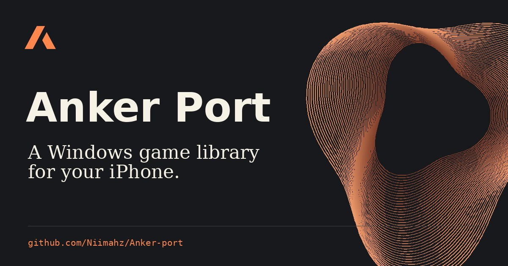
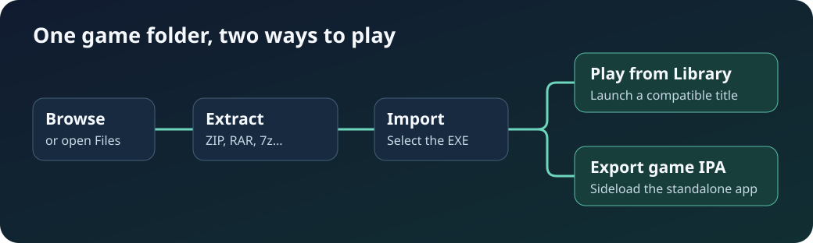

# Anker Port

**Bring a Windows game folder to your iPhone. Play it from your library or build a standalone game IPA.**

Browse to a game archive, download it and unpack it on-device. Pick the main EXE once and open the game from its cover. For a standalone app, export the game files together with a runtime and launch profile. Anker Port brings Anker’s download and import workflow into a native iOS launcher built on Madeira. You supply the game files. Launch compatibility depends on the game, device and JIT setup.

**[Download the unsigned IPA](https://github.com/Niimahz/Anker-port/actions/runs/44961914737/artifacts/14732869981)** · [Browse builds](https://github.com/Niimahz/Anker-port/actions/workflows/build-ipa.yml) · [Report a game result](https://github.com/Niimahz/Anker-port/issues/new?template=game-report.yml)

## Build a standalone game IPA

Open a game’s details and tap **Export game IPA**. Confirm the folder containing its EXE, DLLs and assets. Choose **With JIT** for the Madeira-based runtime, or **JITless · Native interpreter** for experimental local execution of compatible 32-bit x86 Windows games. The JITless game app uses a native interpreter without WebKit.

Look in **Files → On My iPhone → Anker Port → Anker IPA** for the finished package. Sign or sideload the exported IPA, then open the game as its own app. Keep enough free space for a writable copy on first launch. A successful export confirms that the app was packaged. Game compatibility and performance still depend on the chosen runtime.

## Get started

1. Sign in to GitHub and download the build artifact above. Open the ZIP in Files to find **AnkerPort-unsigned.ipa**. If the artifact has expired, open the builds page and choose the latest successful IPA build.
2. Import the IPA into your configured LiveContainer setup, or sign it with your iOS sideloading tool. For game execution, check **JIT** in Settings.
3. Open **Downloads** and paste a direct HTTPS file link, or use **Browser** to download from a website. You can also start with a game folder you already have in Files.
4. In **Downloads → Files**, find your archive and tap **Extract** if needed. Import the extracted game folder, keeping the EXE, DLLs and assets together. If the app finds multiple executables, choose the game’s main EXE.
5. Open **Library → Collection**, tap the game’s cover, then **Play**.

## Browse, download and play

| Destination | What you can do |
| --- | --- |
| Home | Return to a recently played game or jump to your library. |
| Library | Browse your collection by cover art, open game details, or switch to Sources. |
| Downloads | Paste a direct HTTPS link or open a downloaded archive in Files. Extract it on-device, import the whole game folder and look up the title on Steam. |
| Browser | Enter a website address and follow its own download links. Back, Forward and Reload keep the source page within reach. |
| Settings | Check JIT and Memory+, then open controls grouped under Stores, Gameplay, Device and App. |

### Archive support

ZIP (including ZIP64), RAR/RAR5, 7z, TAR, TAR.GZ/TGZ and single-file Gzip. ZIP methods include Store, Deflate, LZMA, Zstandard (93), XZ (95) and PPMd. Password-protected archives and entries containing links have extraction limitations. A game that extracts successfully may still need runtime-specific settings to launch.

## Build and contribute

The macOS workflow builds the native iOS target and packages the unsigned IPA. The runtime source revision, integration scripts and packaging checks are tracked in this repository. Store clients, saves outside the game folder and globally installed prerequisites are separate.

[Native build guide](docs/NATIVE-BUILD.md) · [Architecture](docs/ARCHITECTURE.md) · [Issues](https://github.com/Niimahz/Anker-port/issues) · [Press kit and shareable artwork](docs/PRESS-KIT.md)

## Credits

**Nima HZ (@Niimahz)** created Anker Port. The native runtime comes from Will Faust’s Madeira project and its contributors, including upstream work on Wine, FEX and DXMT. Archive extraction uses libarchive, XZ and Zstandard. The standalone interpreter uses Boxedwine and SDL. Component licenses and upstream notices apply to their respective code. The app includes contributor credits under **Settings → App → Credits**.

[Anker Game Downloader](https://github.com/Niimahz/Anker_build) · [Madeira source used by this build](https://github.com/willfaust/Madeira/tree/fbad430410b4075192166172447c859714726de9)
